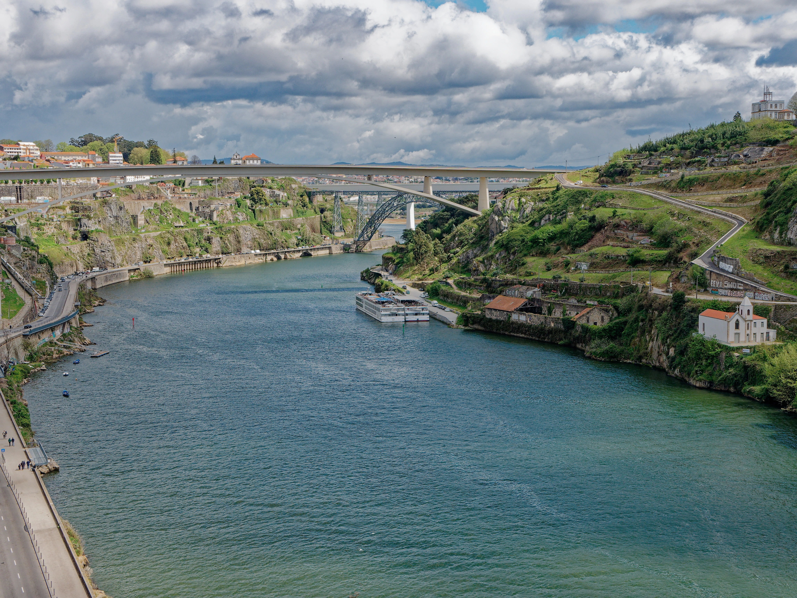
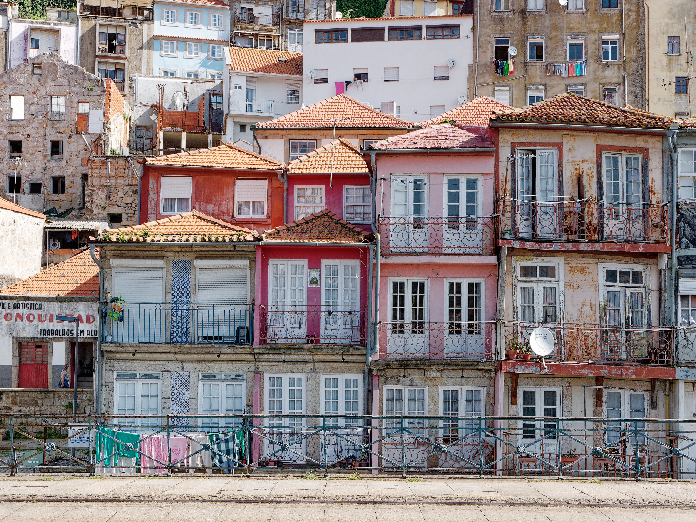
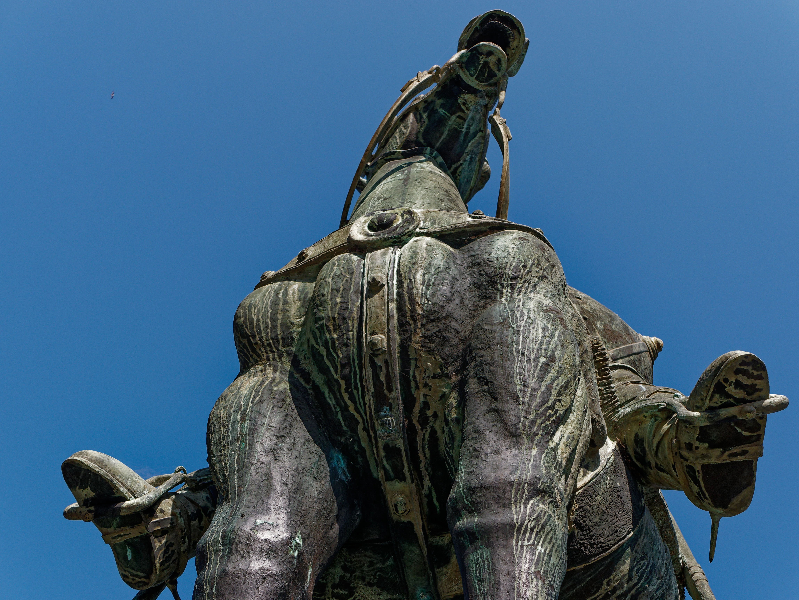
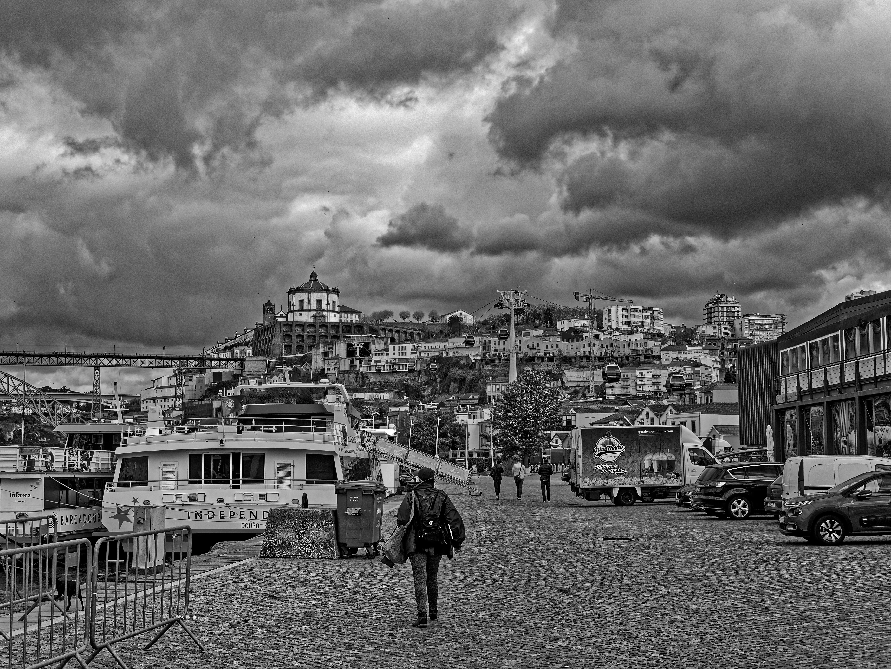
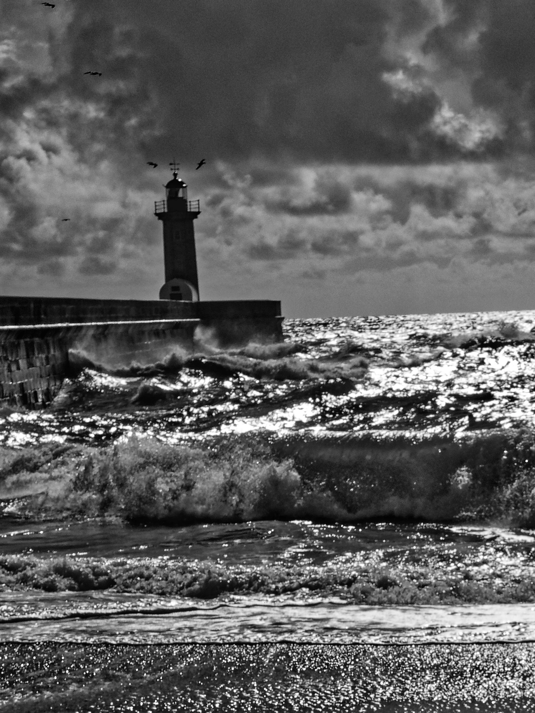
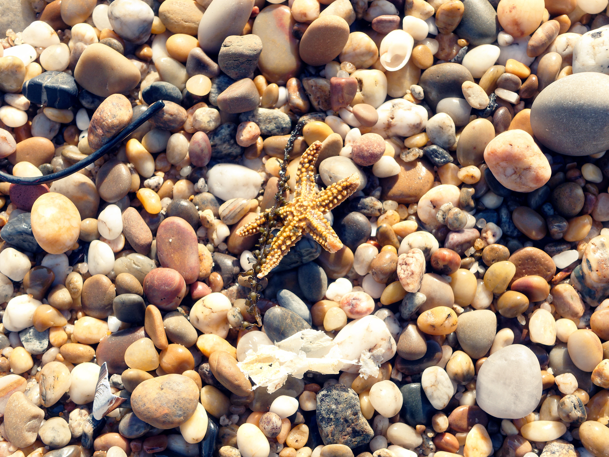
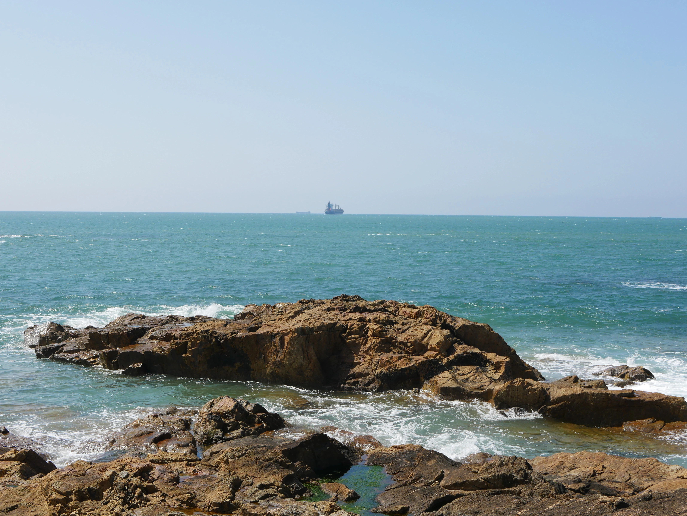
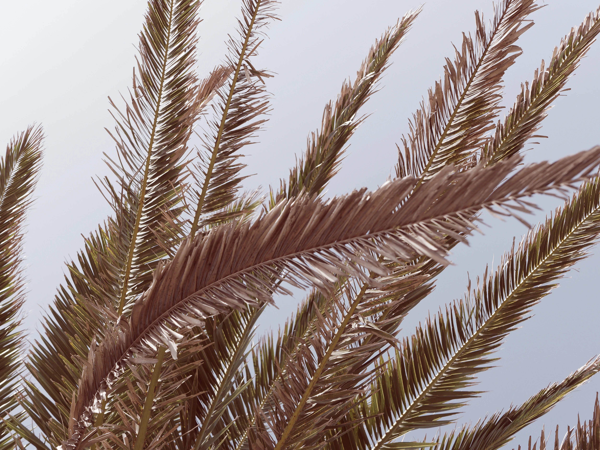

Portugal at the turn of March and April 2022 — from Lisbon's monumental Praça do Comércio, through the narrow, vibrant streets of Ribeira and the dramatic Douro river gorge in Porto, to the powerful Atlantic surf crashing against the historic Farol de Felgueiras.


  
  
  
  
  
  
  
  

