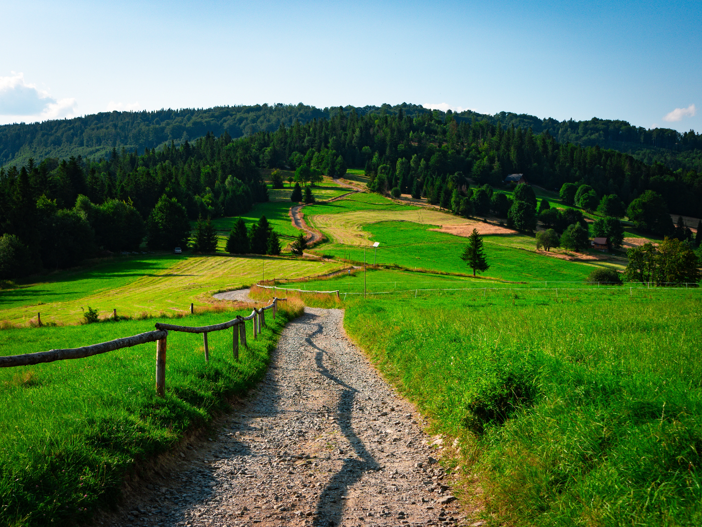
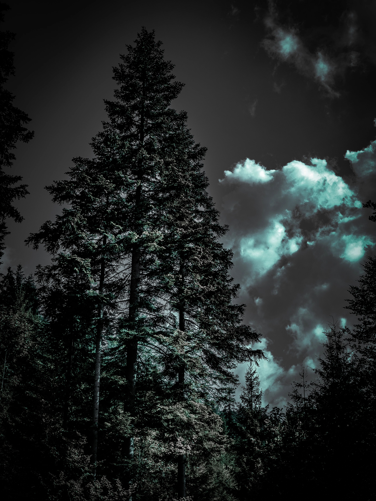
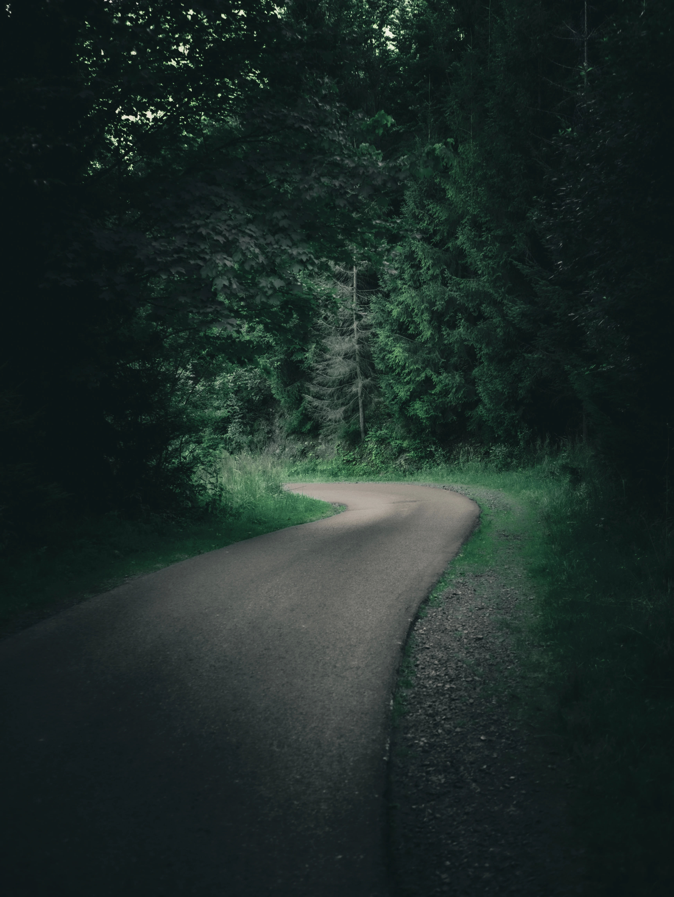
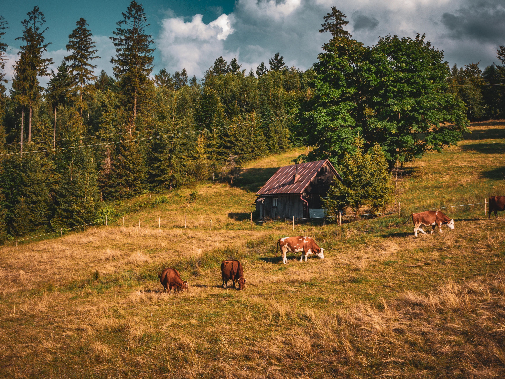
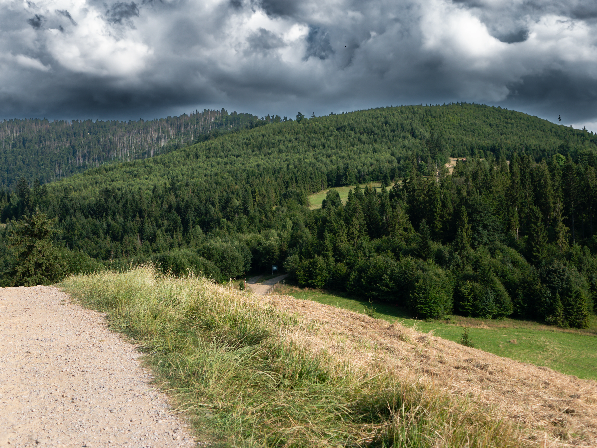
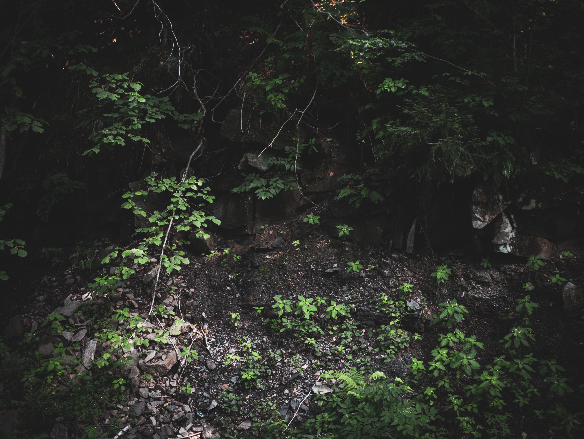

Beskid Żywiecki has secluded corners where you can find mountain trails just as we imagine them — empty, untouched by civilization, yet filled with beautiful nature and landscapes.


  
  
  
  
  
  

