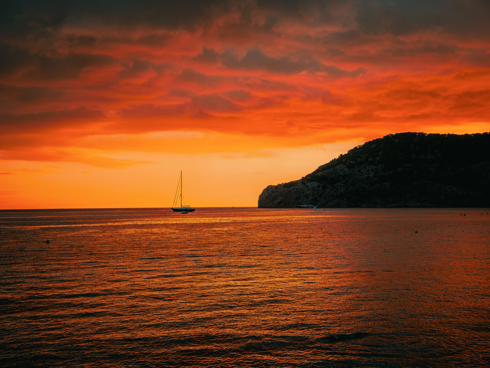
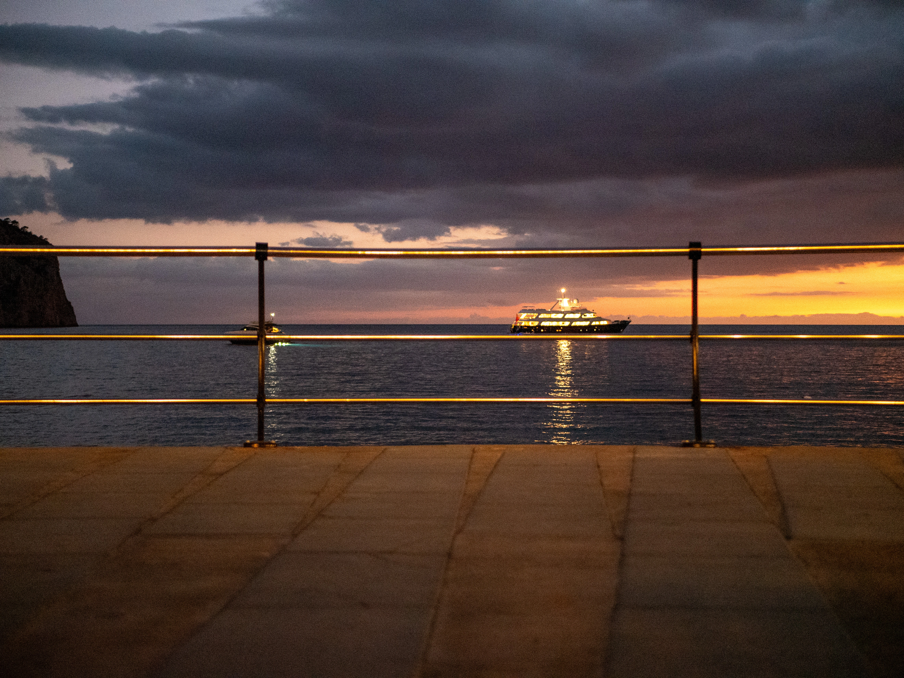
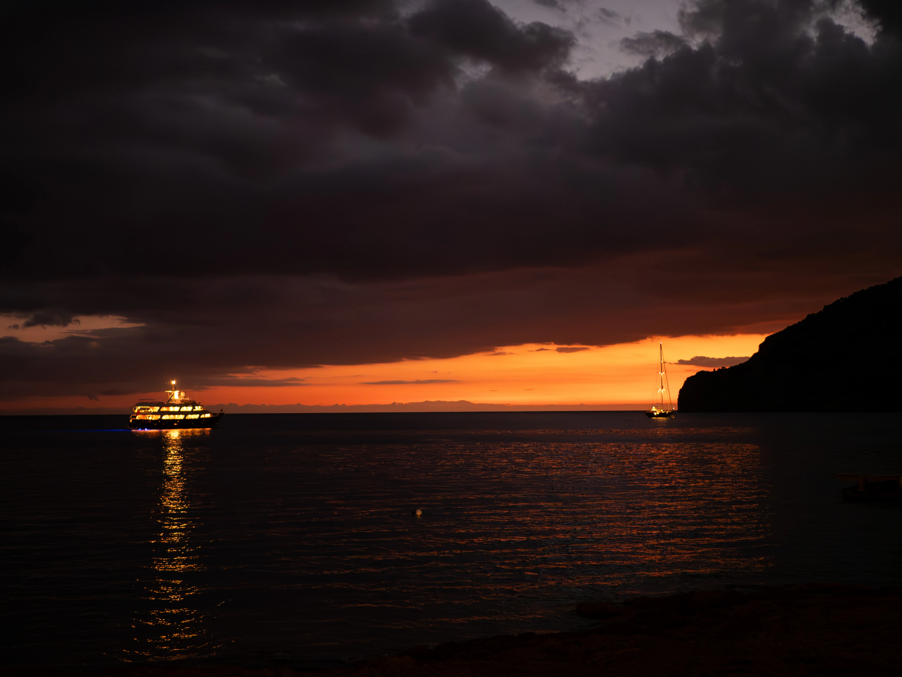
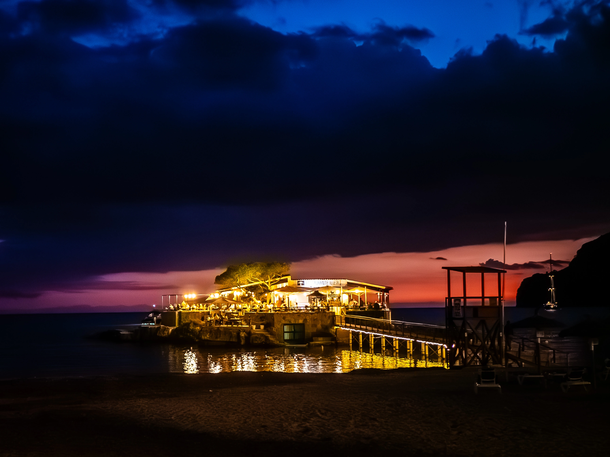
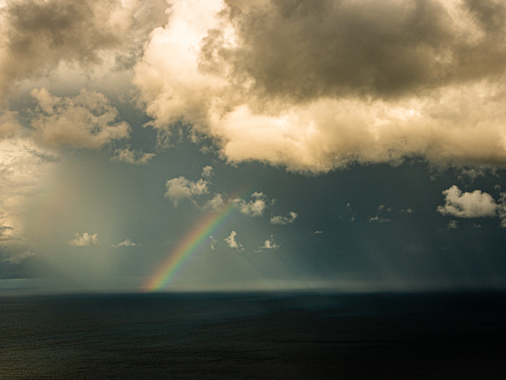
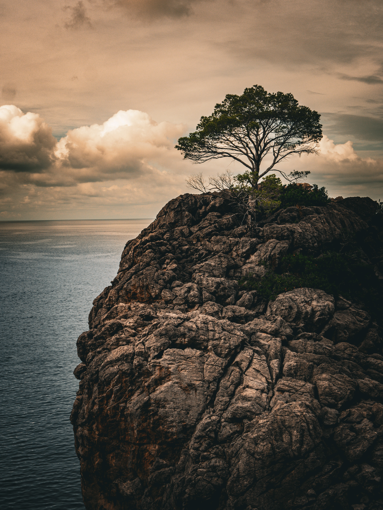
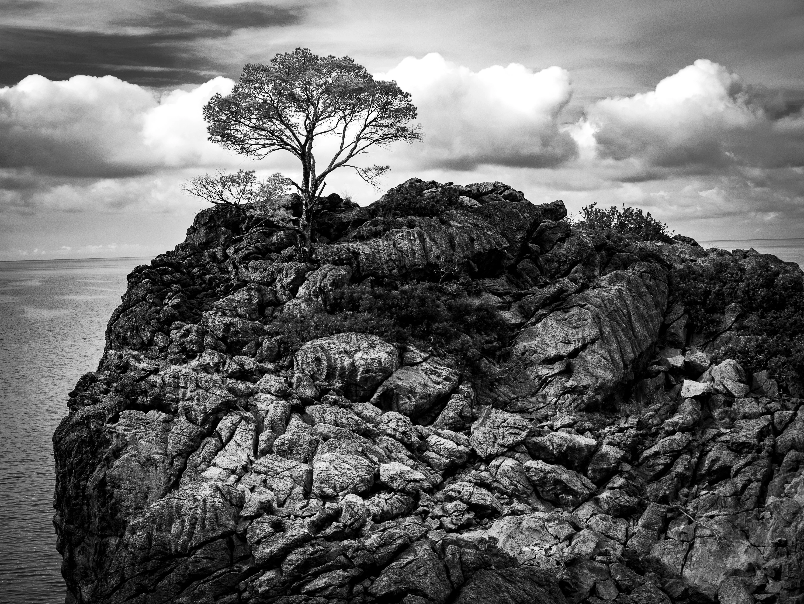
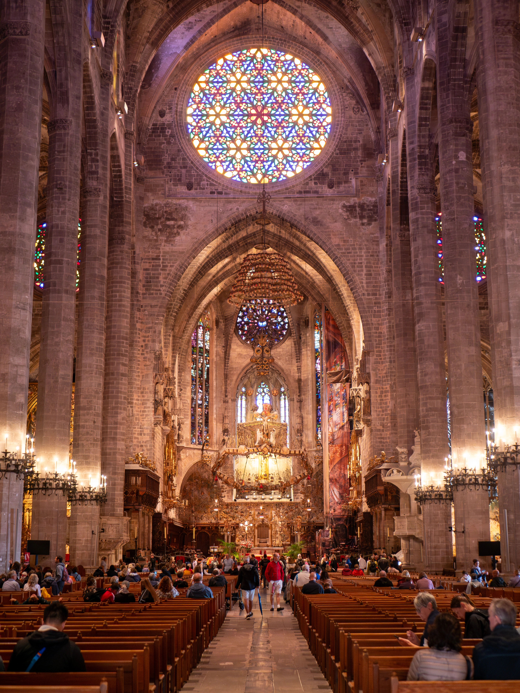
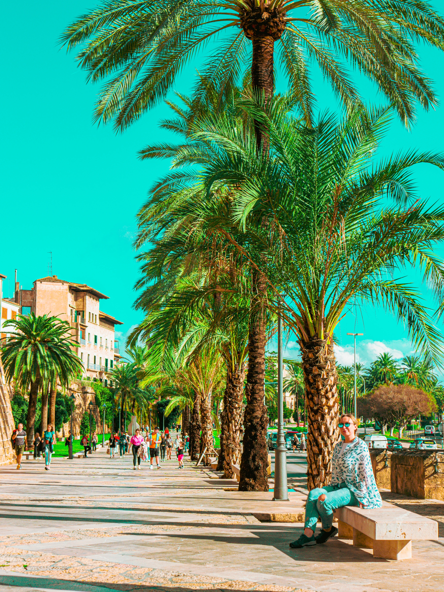

Październikowa Majorka to czas, kiedy wyspa zwalnia tempo po letnim szczycie sezonu. Ogniste zachody słońca w zatoce Camp de Mar, tęcza przecinająca burzowe niebo nad morzem, surowe wybrzeże Serra de Tramuntana z samotną sosną na skale i niezwykła gra światła w katedrze La Seu w Palma de Mallorca.


  
  
  
  
  
  
  
  
  

