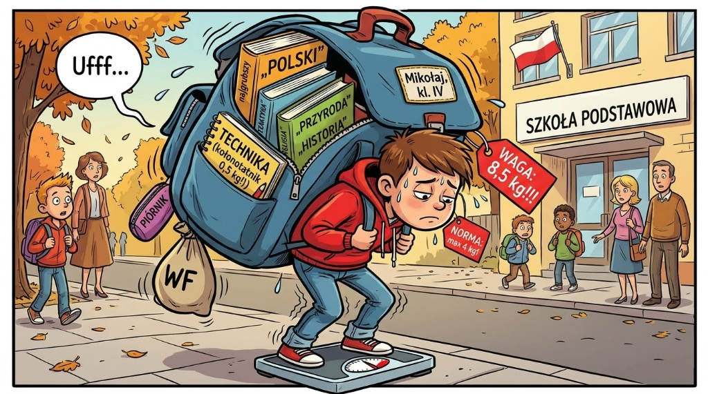

Mikołaj (my awesome son) is in the fourth grade. This year starts a new subject called "Nature Studies", which includes basic research methodology. Amid the recurring national debate regarding the excessive weight of school backpacks, I decided to run an experiment for my child's homework: weighing every single item in the backpack to find out which item weighs the most — and therefore, which subject is "heaviest".

## Weighing

The raw data is available [in CSV format on GitHub](https://github.com/kamilsi/kamil_Rblog/blob/master/Rdata/plecak.csv).

| Subject | Item | Weight (g) |
| --- | --- | --- |
| Polish | Workbook | 296 |
| Polish | Literature Textbook | 717 |
| Polish | Grammar/Spelling Textbook | 521 |
| Polish | 60-page notebook | 142 |
| Math | Textbook | 383 |
| Math | Workbook | 166 |
| Math | 60-page notebook | 148 |
| Nature | Atlas | 363 |
| Nature | Textbook | 345 |
| Nature | Workbook | 277 |
| Nature | 60-page notebook | 229 |
| Religion | Workbook | 208 |
| Religion | Textbook | 224 |
| Religion | 60-page notebook | 136 |
| Technology | Textbook | 192 |
| Technology | 100-page notebook | 564 |
| English | Textbook | 327 |
| English | Workbook | 240 |
| English | 60-page notebook | 148 |
| History | Textbook | 341 |
| History | 60-page notebook | 143 |
| Music | Textbook | 298 |
| Music | 16-page notebook | 62 |
| Art | Textbook | 167 |
| Art | 16-page notebook | NA |
| IT | 60-page notebook | 159 |
| Accessories | Folder | 60 |
| Accessories | Pencil case | 355 |
| Accessories | Schoolbag | 1000 |
| PE | Shorts | 85 |
| PE | T-shirt | 95 |
| PE | Shoes | NA |
| PE | Gym bag | 117 |

Total weight: **8498g (~8.5 kg)**.

## Notebooks

The first thing that stood out was the huge variance among 60-page notebooks:

The Nature notebook (the outlier above the 60-page cluster) had a hardcover, similar to the Technology spiral notebook with 100 pages and heavy cardboard covers (which alone weighed **half a kilogram** (!)). First takeaway: avoid hardcovers and spiral notebooks; substantial weight can be saved right here.

## Accessories

How much do the stationary accessories weigh?

| Subject | Item | Weight (g) |
| --- | --- | --- |
| Accessories | Folder | 60 |
| Accessories | Pencil case | 355 |
| Accessories | Schoolbag | 1000 |

Fixed overhead comes out to **1450g** — reasonable.

## Textbooks

Now the core question: how much do textbooks weigh per subject?

The results are clear: the heaviest subject is not math, but Polish, where 3 books (2 textbooks and 1 workbook) alone weigh 1.5kg. Add the backpack and pencil case, and that's 3kg. If Nature lands on the same day, we hit 4kg — dangerously close to the maximum recommended limit for a fourth grader.

Noticeably absent: **Computer Science (IT)**, which weighs a solid 0g (no textbook, no workbook).

## Can we stay under 6kg per day?

Based on the weekly class schedule, the daily backpack load is:

| Day | Book weight (g) | Weight with bag (g) |
| --- | --- | --- |
| Friday | 3238 | 4638 |
| Monday | 3385 | 4785 |
| Thursday | 3699 | 5099 |
| Wednesday | 4461 | 5861 |
| Tuesday | 4911 | 6311 |

Health guidelines suggest that a child's backpack should not exceed 10–15% of their body weight. For 9-year-olds (averaging 25–41 kg), this corresponds to a **maximum** safe weight between 3.75kg and 6.15kg.

In practice, without lockers or schedule optimization, daily bags regularly breach the recommended safety thresholds.
