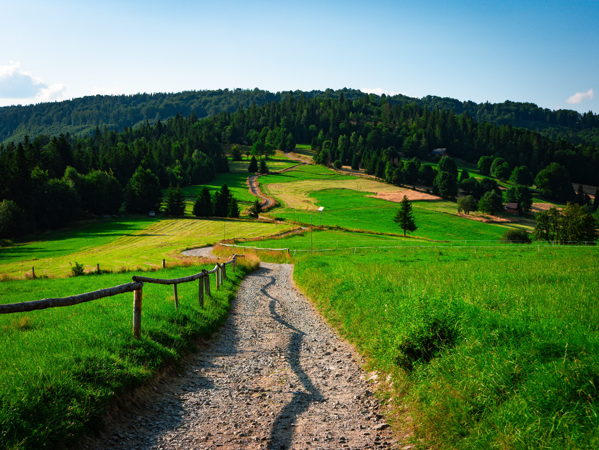
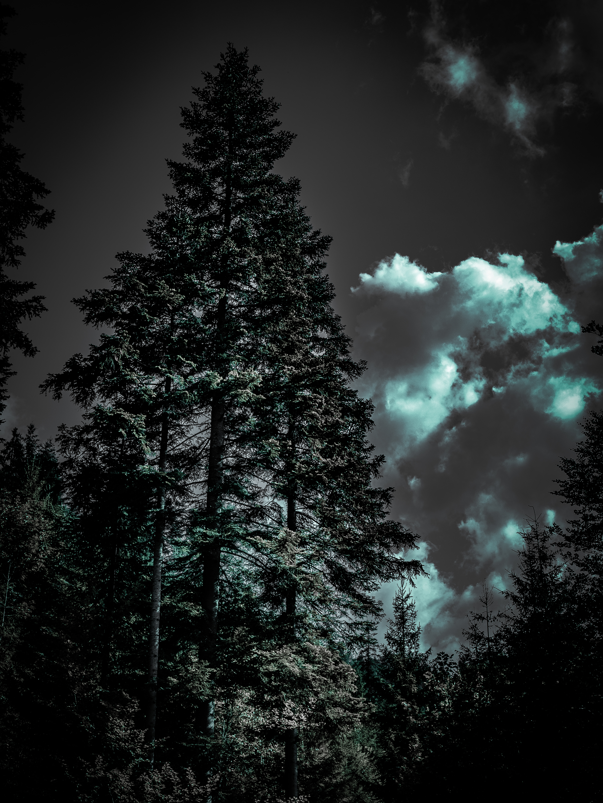
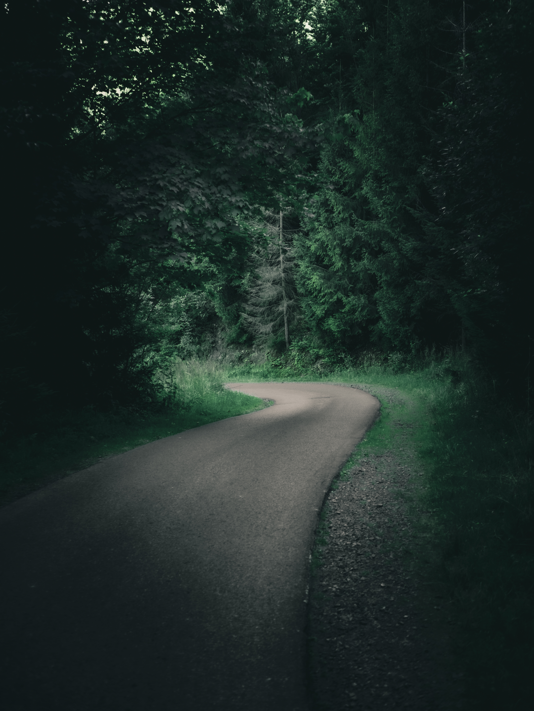
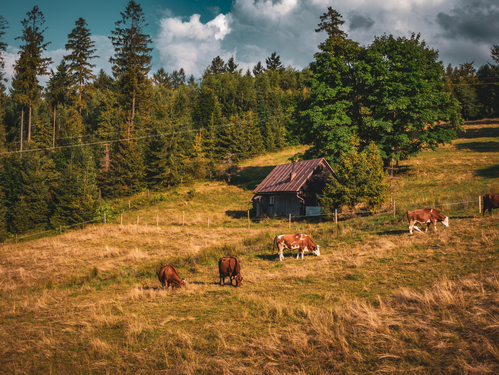
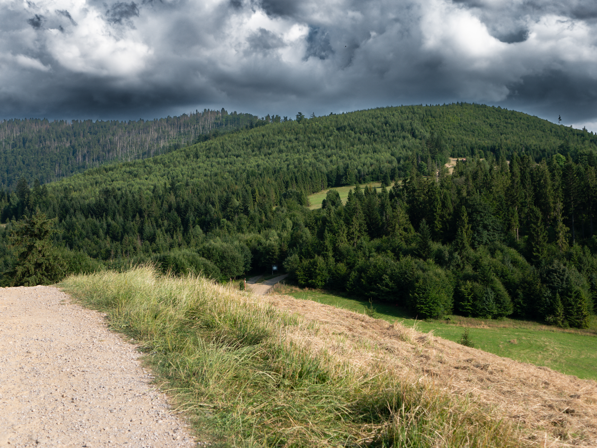
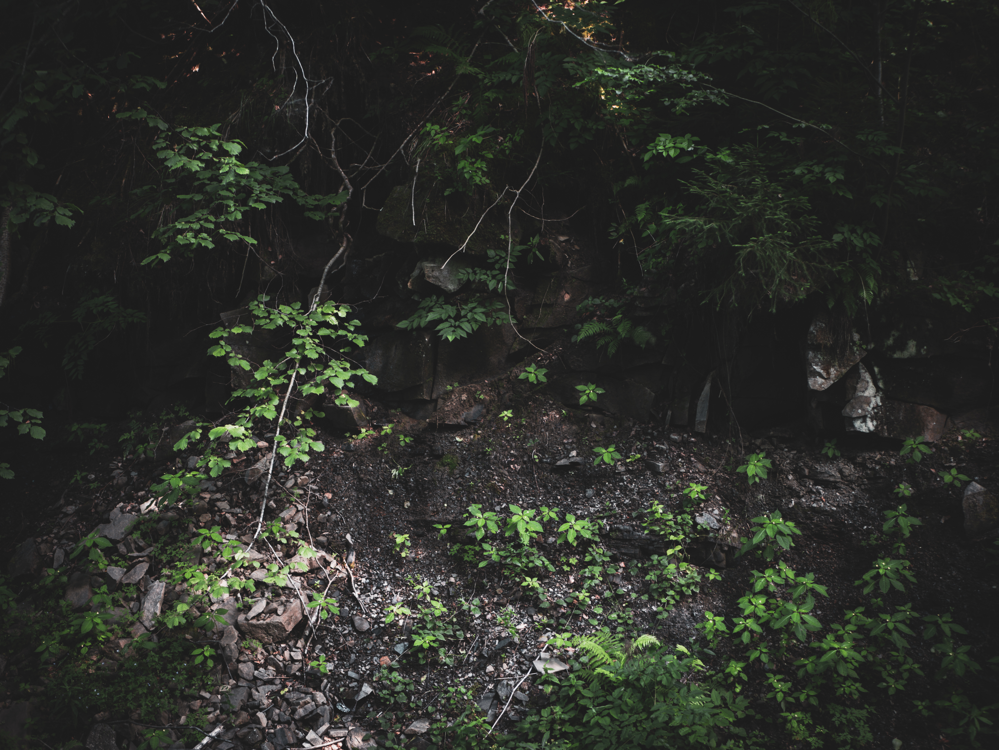

Beskid Żywiecki ma zakamarki gdzie można znaleźć szlaki w górach takimi, jakimi je sobie wyobrażamy – pustymi, bez śladów cywilizacji, a za to z piękną przyrodą i pejzażami.


  
  
  
  
  
  

